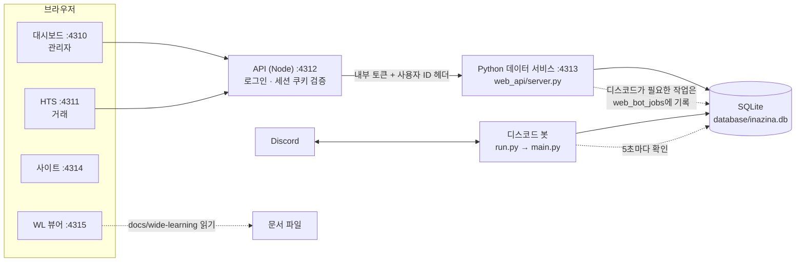
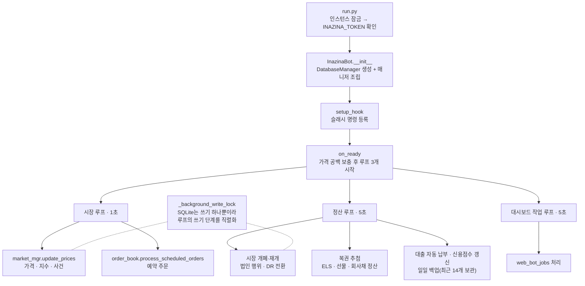
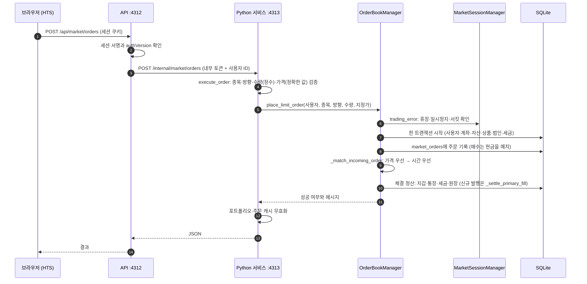
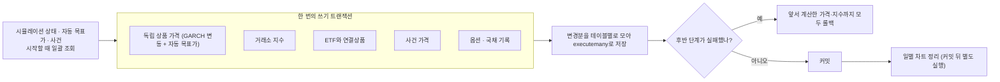
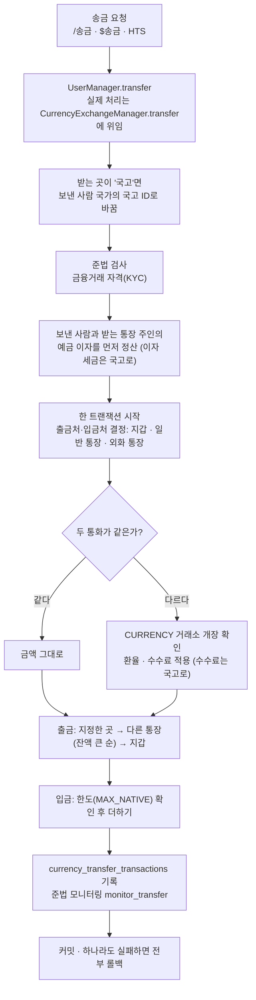
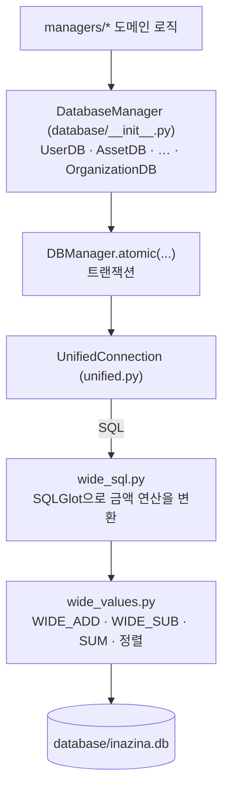
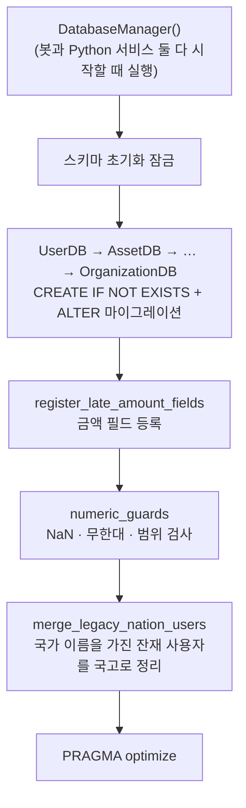
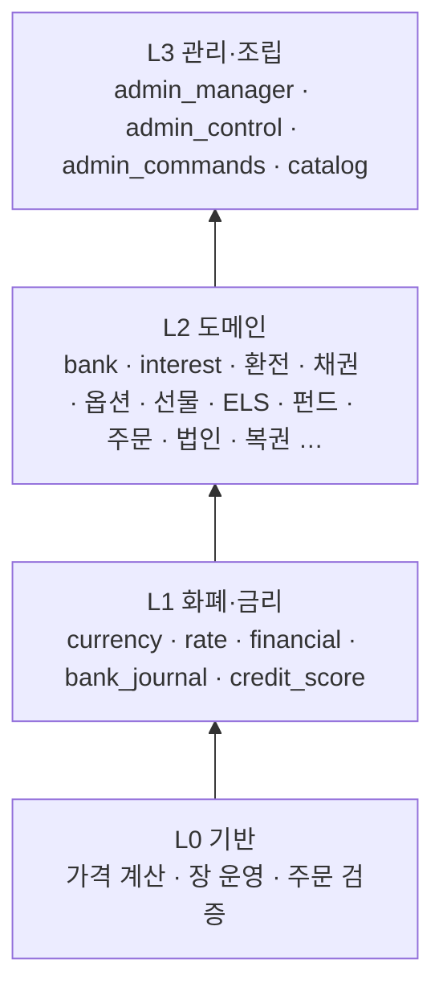

# 인수인계서

다음 개발자가 첫날 읽는 문서다. 시스템이 어떻게 이어져 있는지, 어디를 보면 되는지, 무엇을 조심해야 하는지를 적었다. 세부 설계는 마지막의 [문서 지도](#8-문서-지도)에서 찾는다.

> 현재 버전은 **3.0 Dawn (Laplace)** 이다. 이전 버전은 1.0 Simpsons, 2.0 ArcadiaBene이고, 3.0 Dusk (Fourier)와 3.0 Midnight (El!xer)는 예정이다.

## 1. 한눈에 보기

- 디스코드 서버에서 운영하는 가상 국가·금융 경제 시뮬레이터다. 통화·국고·은행·대출·주식·ETF·옵션·선물·ELS·채권·펀드·복권·게시판을 한 SQLite DB 위에서 함께 다룬다.
- 프로세스는 셋이다. **디스코드 봇**(Python), **API**(Node/TypeScript), **Python 데이터 서비스**(웹용 HTTP). 모두 같은 `database/inazina.db`를 쓴다.
- 화면은 관리자 **대시보드**, 거래용 **HTS**, 공식 **사이트**, 문서 **WL 뷰어**가 있다(React + Vite).
- 통화·국고·주문·계좌가 한 트랜잭션에서 함께 바뀌어야 해서 서비스를 쪼개지 않은 모놀리스다.

## 2. 서비스 구성



| 프로세스 | 시작 | 하는 일 |
|---|---|---|
| 디스코드 봇 | `run.py` (`start_all.command`가 함께 시작) | 슬래시 명령과 `$` 관리자 명령 처리, 백그라운드 루프(가격·정산·추첨·백업) |
| API | `npm run dev:api` | 로그인·세션·요청 검증. **Python 서비스를 자식 프로세스로 띄우고**, 죽으면 다시 시작한다 |
| Python 데이터 서비스 | API가 시작 | 웹 요청을 도메인 매니저로 실행. 외부에 열리지 않고 내부 토큰으로만 호출된다 |

- API는 서명된 세션 쿠키(`inazina_session`)와 `authVersion`을 확인한 뒤, `x-inazina-internal-token`과 `x-inazina-user-id` 헤더를 붙여 Python 서비스를 호출한다. 관리자가 국가·법인 계정으로 로그인해 일할 때는 `x-inazina-delegated-by`도 전달한다.
- 봇은 디스코드가 있어야 하는 일(DM 발송 등)을 웹에서 직접 못 한다. 그래서 웹이 `web_bot_jobs` 테이블에 작업을 적고 봇이 5초마다 가져가 처리한다(`functions/web_jobs.py`).
- 봇은 체크아웃마다 하나만 실행된다. `database/.inazina-bot.lock`을 잡지 못하면 시작하지 않는다.

## 3. 코드 지도

| 경로 | 역할 |
|---|---|
| `run.py`, `main.py` | 봇 진입점과 `InazinaBot`(매니저 조립, 백그라운드 루프) |
| `managers/` | 도메인 로직(은행·주문·옵션·선물·ELS·채권·펀드·법인·복권·신용·세금 …). 계층 규칙은 [architecture.md](architecture.md) |
| `database/` | DB 모듈(`UserDB`, `AssetDB` …), 트랜잭션(`db_manager.py`), 금액 처리(`unified.py`, `wide_*.py`), 백업·무결성 |
| `functions/` | 디스코드 명령·화면(`slash_commands.py`, `admin_prefix.py`, `*_views.py`), 금액·시간·세금 유틸 |
| `web_api/` | Python 데이터 서비스(`server.py`)와 게시판·문서·조직·검색 지표 |
| `apps/api` | Node API(로그인, 세션, Python 서비스 프록시) |
| `apps/dashboard`, `apps/hts`, `apps/site`, `apps/wl` | 프런트엔드. `apps/shared`는 공용 코드(`money.ts`, `api.ts`, 인증 화면) |
| `config/initial_currency_catalog.json` | 새 설치의 기준통화와 통화 목록 |
| `tests/` | Python 테스트 약 90개 파일 |
| `tools/` | GeoIP 갱신, WLMD 검사 |

## 4. 코드 흐름

### 4.1 봇 시작과 백그라운드 루프



- 루프는 디스코드 이벤트 루프를 막지 않도록 쓰기 작업을 `asyncio.to_thread`로 실행한다. 느려진 틱을 따라잡는 틱은 쌓지 않는다.
- 오류는 60초에 한 번만 로그에 남긴다. 루프가 죽지 않는 것이 의도다.

### 4.2 웹 요청과 주문 (HTS 지정가 주문)



- 소수점 거래를 허용한 종목(`Fractal=1`)은 `FractionalTradingManager`로, ELS는 청약 경로로 갈라진다.
- 체결·예치·세금·원장은 **같은 트랜잭션**이라 중간에 실패하면 전부 되돌아간다.

### 4.3 가격 갱신 (1초마다)



- 관리자가 정한 사건 목표가는 자동 목표가보다 우선한다.
- 가격 계산은 `managers/stochastic_price_engine.py`와 `managers/_price_math.py`(선택적으로 Cython 컴파일)이 맡는다. 가격이 2^53을 넘으면 `ExactDecimal`로 계산한다. 자세한 설계는 [performance.md](performance.md).
- 봇이 꺼져 있던 시간의 차트 공백은 시작할 때 채운다(`price_gap_filler`).

### 4.4 돈이 움직이는 길 (송금)



- **송금 직전에 이자 정산이 먼저 일어난다.** 그 이자의 세금은 국고로 들어가므로, 국고로 송금하면 국고 증가분이 송금액보다 이자 세금만큼 클 수 있다. 버그가 아니다.
- `UserManager.transfer`의 `return` 아래에 있는 옛 구현은 도달하지 않는 코드다(이관 기록용으로 남아 있다). 송금 동작을 고칠 때는 `managers/currency_exchange_manager.py`를 본다.
- 국가의 계정은 국고 하나다. 국고 ID는 숫자이고 그 국가의 로그인 ID이기도 하다(`country_treasuries` 테이블, `CurrencyManager.treasury_id`).

### 4.5 DB 계층과 큰 금액



- 금액 열은 TEXT이고 큰 값은 `~M~…`처럼 태그된 정확한 문자열이다. 연산은 SQL 함수가 정확하게 한다. 10^18 이상 지원의 전체 설명은 [wide_money.md](wide_money.md).
- **금액을 float으로 바꾸지 않는다.** JSON Number, `float()`, `round()`가 끼는 곳이 정밀도 사고의 대부분이다.

### 4.6 서버가 시작할 때 DB가 하는 일



- 마이그레이션은 **시작할 때마다 실행되므로 반드시 멱등**이어야 한다. 새 변경도 `CREATE IF NOT EXISTS`나 "이미 했으면 건너뜀" 형태로 쓴다.
- 스키마를 바꾼 뒤에는 **운영 DB를 직접 열지 말고** 백업 사본에서 시작해 본다.

### 4.7 매니저 계층



- 모듈은 **같은 계층이나 아래 계층만** import한다(함수 안의 지연 import도 포함). `database/`는 `managers/`를 import하지 않는다. 새 매니저를 추가하면 [architecture.md](architecture.md)의 표와 `tests/test_architecture.py`의 `LAYERS`에 계층을 적어야 테스트가 통과한다.

## 5. 실행과 운영

### 5.1 실행

```
npm install
.venv/bin/python -m pip install -r requirements.txt -r requirements-dev.txt
./start_all.command              # 봇 + API + 대시보드 + HTS + 사이트 + WL
```

`.env`에 `INAZINA_TOKEN`이 없으면 봇만 시작하지 않는다. 이미 포트 4310~4315가 쓰이고 있으면 `start_all.command`가 멈춘다. 이전 터미널에서 `Ctrl+C`로 모두 끈 뒤 다시 시작한다.

### 5.2 환경 변수 (값은 저장소에 없다)

| 이름 | 쓰는 곳 | 비고 |
|---|---|---|
| `INAZINA_TOKEN` | 봇 | 디스코드 봇 토큰 |
| `INAZINA_AUTH_SECRET` | API | 세션 쿠키 서명. 없으면 시작할 때마다 새로 만들어져 모든 로그인이 풀린다 |
| `DISCORD_CLIENT_ID`, `DISCORD_CLIENT_SECRET`, `DISCORD_REDIRECT_URI` | API | 디스코드 OAuth(가입·ID 찾기·비밀번호 재설정) |
| `INAZINA_BROWSER_PASSWORD_SHA256` | API, Python | JSON 주소를 브라우저에서 직접 열 때의 입장 암호 해시 |
| `INAZINA_PYTHON_PORT`, `PORT` | API | 기본 4313, 4312 |
| `INAZINA_DB_PATH` | Python | DB 경로. 기본은 `database/inazina.db` |
| `INAZINA_INTERNAL_TOKEN` | Python | API가 시작할 때 만들어 넘긴다. 직접 정하지 않는다 |

### 5.3 백업과 복구

- 봇이 하루에 한 번 일관된 스냅샷을 `database/backups/`에 만들고 최근 14개를 둔다. 지금 백업하려면 `.venv/bin/python -m database.backup`.
- 큰 변경 전에는 `database/backups/`에 이름을 붙여 따로 복사한다. 이미 쓰는 이름 규칙은 `inazina-날짜-시각-before-작업명.db`.
- 무결성 검사는 `.venv/bin/python -m database.integrity`(운영 DB를 읽기 전용으로 검사하고 위반이 있으면 종료 코드 1).

### 5.4 관리자와 국가 명의 실행

- `users.role=admin`인 사용자만 `$` 명령에 응답한다. 관리자 ID 부트스트랩 목록은 `functions/admin_access.py`의 `BOOTSTRAP_ADMIN_IDS`.
- `$login [국가 ID]`로 국가 명의 세션을 시작하면 이후 국가 명령이 그 국가의 국고로 실행된다(`admin_national_sessions`). 전체 명령 표는 [operations.md](operations.md).

### 5.5 테스트와 CI

```
.venv/bin/python -m pytest -n auto      # 전체 (약 3분, 2026-11-01 기준 1,046개 통과)
.venv/bin/python -m pytest tests/test_x.py -k 이름   # 일부
npm run typecheck && npm run build       # 프런트엔드
npm run test:wl && npm run test:hts      # 프런트엔드 단위 테스트
```

- CI(`.github/workflows/ci.yml`)는 파이썬 문법 검사 후 `pytest -n auto`를 돌린다.
- 평소에는 바꾼 기능의 테스트만 돌리고, 병합 전에 전체를 돌린다.
- 새 매니저 파일은 `tests/test_architecture.py`가 계층을 요구하고, 금액 열은 `database/money_columns.py`에 등록해야 한다.

## 6. 알려진 부채와 미완

- **L2 매니저 순환 의존**: `bank ↔ interest ↔ currency_exchange` 등. 끊는 방법은 [architecture.md](architecture.md)의 "알려진 부채".
- **현실화 로드맵**(LAPLACE): M4 회계는 진행 중이고, M6–M8(조달·Basel/ALM, 상품·법률·회수·FX, 보안·준법·최종 스트레스)은 미완이다. [roadmap_laplace.md](roadmap_laplace.md).
- **테이블 소유권**: 매니저가 다른 도메인 테이블에 SQL을 직접 실행하는 곳이 있다. 잔액은 `CurrencyManager.change`, 국고는 `treasury_receive`/`treasury_pay`를 거쳐야 한다.
- **화면 검수의 빈틈**: 운영 DB에는 대출·외화 계좌·주문 데이터가 거의 없어서, 그 필드가 나오는 화면은 실제 데이터로 눈으로 검수하지 못했다. 서버가 일부 숫자를 문자열로 보내므로, 화면에서 숫자 메서드(`toFixed` 등)를 부를 때는 `Number()`로 감싼다.
- **조직(organizations) 기능**: `web_api/organizations.py`, `managers/organization_manager.py`, 대시보드 `OrganizationPage.tsx`는 최근 추가되어 아직 진행 중이다. 기획은 [corporate.md의 기업·주식·지배구조 기획](corporate.md#기업주식지배구조-기획)에 있고, 구현이 기획보다 앞서거나 뒤처질 수 있으니 코드와 함께 읽는다.

## 7. 최근 변경 (2026-10-31 ~ 11-01)

- **큰 금액 지원**: 10^18 이상을 오차 없이 저장·계산. 운영 DB를 새 형식으로 전환했다. → [wide_money.md](wide_money.md)
- **3DSG 장외시장**: 비상장 법인은 거래소 `3DSG`(장외시장)에 속해 거래된다. 코드의 내부 상수 `MarketSessionManager.UNLISTED`가 `"3DSG"`를 가리킨다. 예전 `UNLISTED` 값은 시작할 때 `3DSG`로 옮겨진다(`CompanyDB._rename_unlisted_exchange`).
- **국가 계정 통합**: 국고 계정이 곧 국가의 계정이다. 국가 이름으로 남아 있던 비활성 잔재 사용자를 시작할 때 정리한다(`database/nation_accounts.py`).
- **정식 액면분할·주식분할·액면병합**과 일반 비율분할. → [corporate.md](corporate.md)
- **HTS 검색**: 국가별 기준금리·법정 최고이자·거래소 지수를 검색할 때만 일반 결과 행으로 보여준다(`web_api/search_indicators.py`, `apps/hts/src/SearchIndicators.tsx`). 환율은 환율 행으로만 보이고 실시간 차트로 가지 않는다.
- **재무제표 자동 보정**, 베팅·로또 재원을 통장에서 선택, 송금 상대 user ID 표시 등.

## 8. 문서 지도

| 문서 | 내용 |
|---|---|
| [architecture.md](architecture.md) | 모듈 계층, 의존 규칙, 참조 무결성, 알려진 부채 |
| [operations.md](operations.md) | 운영 안내와 관리자 명령어 전체 표 |
| [products.md](products.md) | 옵션·금리·사건·투자상품, 우선주·ELS, 복권, 시장 정지·사건 가격 경로 |
| [finance.md](finance.md) | 국적과 화폐, 회사 재무제표, 금액 필드 인벤토리, 개인 신용점수 |
| [corporate.md](corporate.md) | 기업·주식 구조, 액면분할·주식분할·액면병합 |
| [wide_money.md](wide_money.md) | 10^18 이상 금액 처리와 DB 전환 |
| [roadmap_laplace.md](roadmap_laplace.md) | LAPLACE 금융 시뮬레이터 현실화 계획과 진행 현황 |
| [performance.md](performance.md) | 디스코드 응답·가격 갱신·Cython 성능 기록 |
| [ui.md](ui.md) | 디스코드 화면 규칙과 HTS 화면 설계 |
| `wide-learning/` | WL 뷰어가 읽는 자료. `tools/wlmd_check.py`와 테스트가 형식을 검사하므로 **이름과 구조를 바꾸지 않는다** |
| `../CHANGELOG.md` | 변경 내역 |

## 9. 인수 첫 주 체크리스트

1. `npm install`, 가상환경과 의존성 설치, `pytest -n auto`가 통과하는지 확인한다.
2. 운영 DB를 **복사해서** 그 사본으로 API와 대시보드를 띄워 본다(`INAZINA_DB_PATH`). 운영 DB에는 실험하지 않는다.
3. 4.1~4.7의 도식을 따라 `main.py`, `web_api/server.py`, `managers/order_book_manager.py`를 한 번씩 읽는다.
4. `database/backups/`에서 복구 연습을 한다(복사 → 사본에서 시작).
5. [wide_money.md](wide_money.md)의 "운영 주의"와 "겪은 함정"을 읽는다. 금액 관련 변경은 여기서 가장 많이 사고가 난다.
6. [roadmap_laplace.md](roadmap_laplace.md)에서 다음에 할 일을 고른다.
